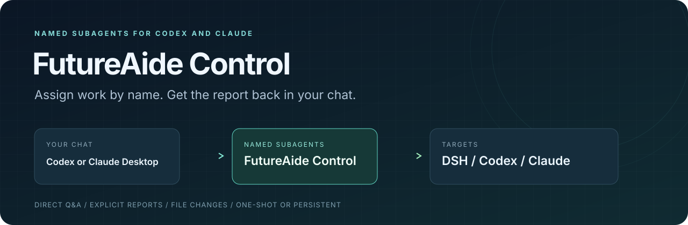

# FutureAide Control

**Antigravity · Codex · Claude 跨端无头子代理军团控制器（v2.3.0）**

只要开着 **Antigravity（反重力）、Codex 或 Claude** 任意一个主对话当 Boss，就能按角色或名字直接调遣 **`codex-cli`、`claude-cli`、`agy-cli` 三大无头 CLI 军团**在后台并行干活。

不用多开一堆桌面窗口，不用传项目路径和内部会话 ID，更不用建临时 txt 传信文件——只给角色和一句话，插件自动选模型、排工号、切独立 Git 分支、锁代理端口；下属遇到卡点秒级问回原聊天，交完终报自动销户清场。

[核心亮点](#v23-核心亮点) · [三端与三极架构](#三端主对话--三极无头军团) · [快速开始](#快速开始) · [实战用法](#实战用法) · [工具一览](#工具一览) · [常见问题](#常见问题) · [详细说明](REFERENCE.md) · [更新记录](CHANGELOG.md)

QQ 交流群：259109974

---

## V2.3 核心亮点

1. **三足鼎立全无头互调（`codex-cli` · `claude-cli` · `agy-cli`）**
   Antigravity、Codex、Claude 三大客户端任意一个都能坐镇主对话，跨模型家族调起后台无头 `codex-cli`、`claude-cli`、`agy-cli`（另可选附着 `codex-desktop` 原生会话）。写后端用 GPT、画界面用 Claude、做异构审查用反重力，一套接口全打通。
2. **2 参数极简派单 + 批量并发 + `worktree` 独立分支**
   只填 `{ role: "后端", message: "..." }` 两个参数，自动匹配预设后端、模型与推理强度并排号为 `后端1`、`后端2`（也支持外部角色预设表随时热改）；传 `tasks: [...]` 一把并发拉起最多 20 名子代理，加 `worktree: true` 自动切出隔离 Git 工作树互不抢文件，还支持 `timeout_minutes`（1–240 分钟）单次限时兜底。
3. **`<50ms` 极薄回调桥 + 全局 `futureaide-wait` 零打扰唤醒**
   子代理调用 `ask_parent` 提问或 `report_parent(final: true)` 交卷，经本地极薄回调桥 `<50ms` 落库；主对话只需后台挂一条返回的 `wakeCmd`（`futureaide-wait ...`）或调 `futureaide_wait_agents`，平时零 Token 静默等待，一旦有人提问或交终报立刻唤醒并直读正文，中间碎念绝不污染主对话上下文。
4. **Win32 Job Object 内核进程笼 + 无感自动 GC**
   每个无头 CLI 进程树都关进 Windows 内核级 Job Object 进程笼——无论是取消任务、`timeout_minutes` 超时还是宿主意外退出，孙进程与后台命令连根清零，**0 孤儿进程残留**；一次性（`once`）子代理交完终报自动清理退场，闲置线程自动休眠释放内存。
5. **团队会议室黑板 `@后端1` 跨级直问与记忆复活**
   内置共享会议室黑板（`futureaide_board_post` / `futureaide_board_read`）。平级对接口，或 Boss 越过团队长直接发 `@后端1`、`@团队长1/后端2`，被点名的成员自动唤醒（哪怕已休眠或跑完退出，也会带着原会话记忆原地复活）直接回话对表。
6. **`futureaide_team` 一刀统管整队生命周期与 `worktree` 一键合并**
   一个工具搞定全部带队难题：主对话重开后一键接班收编旧队（`adopt`）、撤掉卡壳团队长但保留并提拔其下属（`kick`，默认 `keep_children: true`）、跨级调岗（`reparent`）、巡检清扫无主散人池（`strays` / `sweep`）、FAswitch 切号后免报错断点续跑（`resume`），以及把成员的隔离 `worktree` 代码一键合回主工作区并拆树（`merge`）。
7. **CLI 端口代理硬锁防跑偏 + 实时 Token 账单与卡死黄灯**
   `futureaide_cli_proxy` 为 `codex-cli`、`claude-cli`、`agy-cli` 独立绑定端口或联动 FAswitch 当前档案——启动前先做 TCP 探活与档案一致性核验，不通或错位当场拦截，绝不悄悄直连跑偏；极简视图实时展示如 `"18s · 14.2k tok"` 的紧凑耗时/Token 账单角标、过滤废话后的真实执行步骤，以及静默超时 `stalled: true` 卡顿预警（另可开启内置本地只读 `/board` 状态页）。

---

## 三端主对话 × 三极无头军团

主对话身份与当前项目目录由插件自动核验，创建成员时用 `role` 自动路由或显式指定一次 `target`，之后全程按名字（如 `后端1`）或团队路径（如 `团队长1/后端1`）操作：

| 执行目标 | `target` | 怎么运行 | 适用场景与前提 |
|---|---|---|---|
| **Codex CLI（主力默认）** | `"codex-cli"`（或按角色默认） | 后台无头运行 `codex exec --json` / `resume`，无需开桌面窗口 | 统筹、后端、检索、独立审查；需本机 Codex CLI 已登录 |
| **Claude CLI** | `"claude-cli"` | 后台无头运行 `claude -p`，轮次级回调直连原会话 | 前端、UI 设计、长文改写；需本机 Claude CLI 已登录 |
| **Antigravity CLI** | `"agy-cli"` | 后台无头运行反重力 CLI，共享同一套回调桥与代理锁 | 异构盲审、多模态/长上下文协作；需本机 `agy` CLI 可用 |
| **Codex Desktop（按需）** | `"codex-desktop"` | 经本地调试端口走 Codex 原生 `app-server` RPC | 需在桌面侧边栏保留可见线程时使用；Codex 需由 FAswitch 启动 |

> **历史兼容说明**：早期版本的桌面目标 `dsh` 现已下线退居底层兼容保留，不再作为日常派单目标；存量历史记录仍可只读查看，旧版维护接口见[详细说明](REFERENCE.md#维护接口)。指定目标未就绪时会明确报错，绝不偷偷换成其他后端。

---

## 快速开始

### 环境要求

- **操作系统**：Windows 10 / 11（进程笼基于 Win32 Job Object）
- **基础环境**：Node.js `>= 24.14.0`、Git
- **主对话与 CLI**：Antigravity、Codex Desktop、Claude Desktop 任选其一作为主对话；按需登录 `codex`、`claude`、`agy` 命令行工具（配合 FAswitch 账号与代理管理体验最佳）

### 安装与升级

在 PowerShell 中克隆到**非 C 盘的固定目录**并运行安装脚本（安装器默认拒绝 C 盘路径，并对修改过的客户端配置自动留存备份）：

```powershell
git clone https://github.com/XianYuLSya/FutureAide-Control.git D:\Tools\FutureAide-Control
Set-Location D:\Tools\FutureAide-Control
.\install.ps1
```

安装完成后重载客户端插件连接（或新开一个聊天），在主对话里说一句：

> 检查 FutureAide Control 是否就绪。

模型会调用 `futureaide_status({})`：返回 `ready: true` 即可看到当前识别到的客户端会话、三大无头 CLI 就绪状态、代理路由及可用模型列表。

升级时在原目录执行 `git pull` 并重跑 `.\install.ps1` 即可（建议先让在途任务收尾，若升级后旧后台监工仍在运行，结束 `scoped-worker.mjs` 进程后下次调用会自动拉起新版）。

---

## 实战用法

以下代码块展示的是主对话内部的 MCP 工具调用形式；日常使用时你直接用大白话吩咐主对话即可（例如：“派两个后端开独立分支把登录和鉴权写了，做完合回来”）。

### 1. 2 参数极简派单 & 零轮询等待

日常派活只需 `role` + `message`（自动按角色预设匹配模型与强度，也可显式传 `target / model / effort` 覆盖）：

```text
futureaide_run_agent({
  role: "后端",
  message: "实现用户鉴权中间件并补齐单元测试，完成后用 report_parent(final: true) 交回报单。"
})
```

极简回执一目了然，不塞无用字段：

```json
{
  "name": "后端1",
  "role": "后端",
  "spec": "codex-cli · gpt-6.1-terra (high)",
  "taskKey": "tk-...",
  "wakeCmd": "futureaide-wait --conv ... --keys tk-..."
}
```

拿到回执后**不需要循环轮询**：主对话直接把 `wakeCmd` 放到后台运行（或调用 `futureaide_wait_agents({ taskKeys: ["tk-..."] })`），等 `后端1` 提问或交终报时会自动唤醒，直接拿到内联事件与耗时/Token 账单（如 `"usage": "18s · 14.2k tok"`）。

### 2. 批量并发派单 + `worktree` 隔离分支 + 一键合入

多人同时改同一仓库怕冲突？开启 `worktree: true`，每人领一棵独立 Git 工作树，还能用 `timeout_minutes` 设好超时护栏：

```text
futureaide_run_agent({
  timeout_minutes: 30,
  tasks: [
    { role: "后端", worktree: true, message: "实现订单查询接口与单测" },
    { role: "前端", target: "claude-cli", worktree: true, message: "实现订单筛选栏组件" },
    { role: "调查员", target: "agy-cli", message: "核查现有分页参数边界" }
  ]
})
```

全员跑完验收无误后，用 `futureaide_team` 的 `merge` 动作一键把成员改动合回主工作区并自动拆掉临时工作树：

```text
futureaide_team({ action: "merge", target: "后端1" })
// -> { "action": "merge", "ok": true, "summary": "...", "mergedFiles": ["src/orders.mjs", "tests/orders.test.mjs"] }
```

### 3. 团队会议室黑板 `@` 跨级直问

不管团队有几层（比如 `Boss → 团队长1 → 后端2`），随时可在会议室黑板点名对话、拉齐接口：

```text
futureaide_board_post({ message: "@后端1 @团队长1/后端2 错误码字段统一叫 code，确认后回话。" })
futureaide_board_read({ limit: 20 })
```

被 `@` 的成员会自动唤醒（若原一次性会话已结束，会沿用原上下文复活回答）。

### 4. `futureaide_team` 整队接班、撤将留兵、切号续跑与散人治理

```text
# 主对话换了新窗口？一键把同项目旧会话留下的队伍收编过来
futureaide_team({ action: "adopt", target: "auto" })

# 团队长1 卡住了，撤掉它但保留它手下的后端1、后端2 直归上级管（默认 keep_children: true）
futureaide_team({ action: "kick", target: "团队长1", keep_children: true })

# 额度用尽在 FAswitch 切了新号，让中断的成员原地接着跑，不丢进度
futureaide_team({ action: "resume", target: "后端2", message: "账号已切换，继续跑完剩余测试" })

# 巡检并清扫失联超时的无主散人
futureaide_team({ action: "strays" })
futureaide_team({ action: "sweep" })
```

### 5. CLI 端口代理防跑偏硬锁

防止无头 CLI 走错节点或漏回直连：

```text
# 查看三大无头 CLI 当前代理路由与 FAswitch 档案对齐状态
futureaide_cli_proxy({ action: "status" })

# 为 agy-cli 显式锁死本地代理端口（或传 "faswitch" / "direct"）
futureaide_cli_proxy({ action: "bind", target: "agy-cli", proxy: 17913 })
```

### 6. 忙时插话与排队（`mode` 与 `delivery`）

向正在运行中的成员调用 `futureaide_send_agent`（或同名 `futureaide_run_agent`）时，可通过 `mode` 精确控制输入时机：

| `mode` | 行为说明 |
|---|---|
| 省略 | 按目标原生习惯处理：`codex-desktop` 插入当前活动轮；无头 CLI（`codex-cli` / `claude-cli` / `agy-cli`）排在当前轮结束后下一轮执行 |
| `"steer"` | 明确要求插进当前正在执行的轮次；若当前空闲则直接开新一轮 |
| `"queue"` | 明确排在当前轮之后单独开下一轮；注意当成员有待答提问时，显式 `"queue"` 只排补充、绝不代答问题 |

目标不支持所选模式时会直接拒绝并返回 `error.code: "mode-unsupported"`、`error.target` 与 `error.supportedModes`（`accepted: false`，不入队、不改模型）：

| 目标 | 忙时省略 `mode` | 显式 `"steer"` | 显式 `"queue"` |
|---|---|---|---|
| `codex-cli` / `agy-cli` | 排入轮间，下一轮开始 | 拒绝，`supportedModes: ["queue"]` | 排入轮间，下一轮开始 |
| Claude CLI (`claude-cli`) | 排入轮间，下一轮开始 | 拒绝，`supportedModes: ["queue"]` | 排入轮间，下一轮开始 |
| Codex Desktop (`codex-desktop`) | 插入当前轮 | 插入当前轮 | 等当前轮结束后开新轮 |

传入 `detail: true` 或调用 `futureaide_inspect_agent({ name })` 查看 `inputs` 时，可核对每条输入的真实投递去向 `delivery`（包括 `local-pending`、`after-current`、`current-turn`、`new-turn`、`answer-pending`、`answered`、`accepted-route-unknown`、`unknown`、`blocked`）。

---

## 工具一览

| 工具 | 用途 |
|---|---|
| `futureaide_status` | 核验当前主对话身份、三大无头 CLI 与桌面目标就绪状态、代理路由及可用模型 |
| `futureaide_cli_proxy` | 查看（`status`）或绑定（`bind`）`codex-cli` / `claude-cli` / `agy-cli` / `all` 代理出口 |
| `futureaide_run_agent` | 一步创建并派单（支持 `role` 2 参数极简派单、`tasks` 20 路并发、`worktree: true`、`timeout_minutes`、`mode`） |
| `futureaide_create_agent` | 预留角色或具名成员而不立即启动模型轮次 |
| `futureaide_send_agent` | 向已有成员（支持 `团队长1/后端1` 跨级路径）追加任务或补充说明，可更新模型/强度与 `mode` |
| `futureaide_answer_agent` | 按名字或跨级路径回答成员的 `ask_parent` 待答提问，原任务继续推进 |
| `futureaide_list_agents` | 三档极简名单：`team`（本队层级树、真实动作、`stalled` 预警、`usage` 账单）、`agent`（单人详情）、`all`（全机总览） |
| `futureaide_wait_agents` | 按 `taskKeys`（或 `names`）阻塞等待提问或终报，支持 `barrier: "all" \| "any"` 与游标续等 |
| `futureaide_board_post` | 在团队会议室黑板发言，`@后端1` 或 `@团队长1/后端2` 自动跨级唤醒或复活对应成员 |
| `futureaide_board_read` | 按条数或 `after_seq` 增量读取团队会议室黑板记录 |
| `futureaide_team` | 整队治理：`adopt`（收编）、`kick`（撤将留兵/强停）、`reparent`（调岗）、`resume`（续跑）、`strays` / `sweep`（散人巡检清扫）、`merge`（合入 `worktree` 并拆树） |
| `futureaide_read_report` | 当超长报告需要逐字分页读取原文时，按 `task_key` 与 `submission_ref` 分页拉取 |
| `futureaide_agent_changes` | 查看成员及其下属改动过的文件列表与归属说明 |
| `futureaide_inspect_agent` | 查看成员或指定树节点（`node`）的对话详情、`inputs` 投递记录与历史轮次 |
| `futureaide_cancel_agent` | 停止成员当前任务并连根回收其 Job Object 进程树，保留会话上下文 |
| `futureaide_delete_agent` | 关闭并移除成员及其下属会话记录，保留项目业务文件 |
| `futureaide_feedback` | 将插件故障（`problem`）或卡手体验（`friction`）记入本机反馈收件箱 |

> 子代理内部自动挂载三个专用上报工具：`ask_parent`（向上级请示）、`report_parent`（交阶段进展或 `final: true` 正式终报）、`feedback`。另有到期残余自动清理工具，详见[自动清理的配置、清单和恢复命令](docs/agent-auto-cleanup.md)。

---

## 常见问题

| 现象 | 排查与处理 |
|---|---|
| `codex-cli` / `claude-cli` / `agy-cli` 显示未就绪 | 调 `futureaide_status({})` 看 `backends.<target>.reason`，通常是对应 CLI 未安装或未完成 `auth login` |
| 报代理不可达或档案错位拦截 | 调 `futureaide_cli_proxy({ action: "status" })` 检查端口与 FAswitch 当前激活档案是否一致，切正档案或重绑端口后用 `futureaide_team({ action: "resume", target })` 续跑 |
| 成员卡片或列表标出 `stalled: true` | 表示运行轮次静默超过阈值；先用 `futureaide_inspect_agent` 看卡在哪，可调 `futureaide_cancel_agent` 或 `futureaide_team({ action: "resume" })` 恢复 |
| 升级代码后新参数或新行为没生效 | 结束本机后台旧版 `scoped-worker.mjs` 进程并重载客户端 MCP 连接，下次工具调用会自动拉起新版监工 |
| Codex 桌面端提示 `Transport closed` | 在文件资源管理器双击 [recover.cmd](recover.cmd) 按提示重启 Codex 连接（保留全部聊天与项目文件），详见[详细说明](REFERENCE.md#transport-closed) |

更多底层协议、生命周期与配置项说明请参阅 [REFERENCE.md](REFERENCE.md)。

## 许可证

[MIT](LICENSE)。第三方代码的许可声明见 [THIRD_PARTY_NOTICES](THIRD_PARTY_NOTICES.md)。
