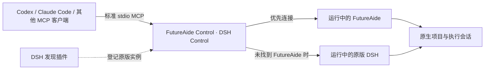

# FutureAide Control

**副名：DSH Control · 把 DSH 接入你的 AI 工作流。**

让 **Codex、Claude Code 等 MCP 客户端**直接创建 DSH 项目对话、指定模型、派发任务并读取结果。你可以在熟悉的 AI 对话里组织工作，让正在运行的 **FutureAide 或原版 DeepSeek Harness（DSH）**承担具体执行。

**少一些复制粘贴，多一些真正的协作。** 从分配任务、选择模型，到检查进度和收回结果，FutureAide Control 把这些操作接成一条可调用的链路。

[快速开始](#快速开始) · [使用场景](#你可以怎样使用它) · [功能一览](#从交办到收回结果) · [FutureAide 计划](#接下来futureaide) · [交流群](#一起把它做得更好)

> **QQ 交流群：259109974**
>
> 欢迎交流 Codex / Claude Code / DSH 协作玩法、反馈使用问题，也一起关注后续便捷一键安装的个人 DSH 改版 **FutureAide**。

## 为什么做这个工具

当你同时使用多个 AI 编程工具时，协作往往靠人来衔接：在这里拆任务，切到另一个工具创建对话，选模型、贴要求，完成后再把结果搬回来。

FutureAide Control 把 DSH 的原生会话能力开放成标准 MCP 工具。当前客户端可以负责需求讨论、任务拆分和结果检查，DSH 会话负责范围明确的调查、实现或验证。你仍然可以在 DSH 的项目列表里找到这些对话，继续查看过程或手动接手。

它适合已经在用 DSH、希望把不同 AI 工具连起来的人，也适合希望**按任务选择模型、减少手工转发、让执行过程留在项目中**的开发者。

## 你可以怎样使用它

下面是配置完成后可以交给客户端的任务意图示例；客户端会结合已加载工具、模型目录和项目权限执行。

### 让当前 AI 对话调度 DSH

> 在 DSH 的这个项目下开一个新对话，选一个可用的 Flash 模型，调查测试失败的原因。先不要改代码，把定位依据和建议整理回来。

客户端可以创建项目会话、显式选模型、发出任务，再读取执行结果。明确的调查或实现任务可以交给合适的模型；涉及方向、取舍和验收的讨论继续留在当前对话。实际费用取决于你的供应商、模型和用量。

### 给不同项目分别安排工作

> 为前端项目和后端项目各建一个执行对话，分别给出任务范围，后续查询都使用各自的连接和会话 ID。

每个任务可以拥有独立 profile 和会话，减少误发到旧项目的情况。多个会话可以分工；若共享同一目录，仍需分配好文件修改范围。

### 找回、接续和修复已有对话

> 看一下这个项目之前的执行对话，读取最近结果。如果旧对话只有工作目录、没出现在项目列表里，帮我补上项目关联。

旧会话可以按原 ID 补关联，保留历史内容；新会话则在创建时完成原生项目关联并核实结果，方便你在 DSH 界面接手。

## 从交办到收回结果

| 你关心的事 | FutureAide Control 提供的能力 |
| --- | --- |
| **连接哪个应用？** | 自动优先寻找可用 FutureAide，没有时寻找已登记的原版 DSH；也支持固定实例。 |
| **任务放在哪个项目？** | 使用原生 `workspaceId` 创建会话，并检查它已进入项目会话列表。 |
| **让哪个模型执行？** | 查询宿主模型目录，显式选择供应商、模型和支持的思考档位。 |
| **执行环境有什么能力？** | 读取会话实际工具、权限、沙箱和计划状态，作为派单依据。 |
| **怎样继续或调整任务？** | 发送排队消息，或在需要时纠偏、取消选定执行轮次。 |
| **怎样拿到结果？** | 读取完成消息、工具记录及持久历史；可选回传到指定 Codex 任务。 |
| **重复请求会不会重复派单？** | 用稳定 `request_id` 保存回执；结果不确定时不自动重发。 |

### 两个组件，各司其职



- **外部 MCP 服务与 CLI**：提供会话控制能力，可接入不同 MCP 客户端。
- **原生 DSH 发现插件**：通过官方插件机制登记运行实例，让桥接能找到原版 DSH。

创建、选模和派单复用宿主原生 API，无需修改 DSH 核心。桥接负责连接已有运行实例，应用的启动与停止由你管理。

## 快速开始

先准备 Node.js 22+、支持 stdio MCP 的客户端，以及一个可正常运行的 FutureAide / DSH Web 宿主。下面以 Windows PowerShell 为例。

<details>
<summary><strong>查看全部 21 个 MCP 工具</strong></summary>

工具名称保留 `futureaide_*` 前缀，FutureAide 和原版 DSH 共用同一调用方式。

| 工具 | 用途 |
| --- | --- |
| `futureaide_spawn_agent` | 一次完成连接、项目会话创建、默认模型核验与派单，返回持久 agentId。 |
| `futureaide_followup_agent` | 只用 agentId 接续任务；保留模型和工作区，忙时不再派单。 |
| `futureaide_wait_agent` | 只用 agentId 收取指定回合的回复，默认即时查询。 |
| `futureaide_cancel_agent` | 只用 agentId 取消当前回合，保留应用和会话。 |
| `futureaide_list_agents` | 找回持久 agentId 与已保存状态。 |
| `futureaide_status` | 检查实例和当前执行会话状态。 |
| `futureaide_connect` | 准备现有连接与能力桥接，不启动模型。 |
| `futureaide_sessions` | 列出项目内会话。 |
| `futureaide_read` | 读取完成消息和工具名称，或诊断事件。 |
| `futureaide_send` | 向选定会话排队或插入任务。 |
| `futureaide_wait` | 阻塞等待刚派出的那一轮跑完并直接取回回复；未结束返回 `running`，再调一次继续等。 |
| `futureaide_watch` | 阻塞等待并保存报告（默认 900 秒、上限 3600）；转后台与自动聊天通知取决于客户端，桥接不保证主动唤醒。 |
| `futureaide_cancel` | 取消选定普通会话的当前任务。 |
| `futureaide_models` | 读取运行中实例的模型目录。 |
| `futureaide_create_session` | 在 profile 的工作区创建会话。 |
| `futureaide_attach_session` | 将已有普通会话关联到其原生项目。 |
| `futureaide_select_model` | 通过宿主 API 选择提供商、模型和推理强度。 |
| `futureaide_capabilities` | 读取会话的工具 schema、权限与运行环境。 |
| `futureaide_notify_codex` | 向 profile 中明确配置的 Codex 任务发送状态回调。 |
| `futureaide_profiles` | 查看默认与命名连接 profile。 |
| `futureaide_profile_create` | 为新的工作区创建独立 profile。 |

</details>

### 前置条件

- Node.js 22 或更高版本。
- 一个正在运行的 FutureAide 或 DSH 实例。
- 使用 DSH 原版时，需安装本仓库提供的原生 DSH 插件，见下文。
- MCP 客户端支持标准 stdio MCP。Codex、Claude Code 和 DSH 都可以作为客户端；本仓库的跨平台代码并不表示已经在所有客户端完成实际验证。

当前主要在 Windows 环境验证。`futureaide_notify_codex` 使用 Windows 桌面集成，属于 Windows 专属能力。

### 1. 获取桥接

以下命令都从仓库根目录运行：

```powershell
git clone https://github.com/XianYuLSya/FutureAide-Control.git
Set-Location FutureAide-Control
npm ci
```

### 2. 让原版 DSH 可以被发现

原版 DSH 需要先通过官方插件命令安装仓库中的发现插件。把路径替换为本仓库的实际绝对路径：

使用 FutureAide 的用户可直接进入下一步；以下步骤用于原版 DSH。

```powershell
dsh plugin --profile web add -w 'D:/Projects/FutureAide-Control/dsh-plugin'
```

然后按你平常的方式启动 DSH。若需要命令行启动，可使用：

```powershell
dsh --profile web --no-open
```

该插件只帮助 FutureAide Control 发现运行中的 DSH。已运行但尚未加载插件的 DSH 进程，通常需要在插件加载后重新启动一次才能被自动发现。

### 3. 接入你的 MCP 客户端

先在任意位置创建本地连接配置，例如 `D:/Projects/dsh-control.json`：

```json
{
  "workspace": "D:/Projects/MyProject",
  "target": "auto"
}
```

`target: "auto"` 会优先连接健康的 FutureAide 实例，再尝试已注册的 DSH 实例。也可以设为 `"futureaide"` 或 `"dsh"` 限制目标。

接着在你的 MCP 客户端配置中加入标准 stdio 服务。路径必须是仓库的实际绝对路径：

```json
{
  "mcpServers": {
    "futureaide-control": {
      "command": "node",
      "args": ["D:/Projects/FutureAide-Control/src/mcp-server.mjs"],
      "env": {
        "DSH_CONTROL_CONFIG": "D:/Projects/dsh-control.json"
      }
    }
  }
}
```

`DSH_CONTROL_CONFIG` 是推荐的通用配置变量；为兼容既有安装，也支持 `FUTUREAIDE_CONTROL_CONFIG`。完成配置后，让客户端重新加载 MCP 服务，再调用 `futureaide_status` 或 `futureaide_connect` 确认连接。上面的 `mcpServers` 是常见 JSON 配置格式，具体入口以客户端为准；Codex 也可以使用本地插件安装方式。

显式 `instanceFile`、`baseUrl` 或启动 URL 始终固定目标；`preferredInstanceFile` 才是允许失效回退的发现提示。若同一优先级有多个健康实例，工具会要求明确指定，避免把任务发错。

新会话会通过原生 `workspaceId` 加入对应项目，并检查项目会话列表；不会仅设置工作目录就宣称关联成功。`futureaide_attach_session` 可修复旧普通会话的缺失关联，保留原 ID 和历史。

### 4. 检查连接，创建第一个项目对话

所有命令从仓库根目录运行：

```powershell
$env:DSH_CONTROL_CONFIG = 'D:/Projects/dsh-control.json'
node src/cli.mjs status
node src/cli.mjs connect --request-id connect-001
node src/cli.mjs sessions --limit 20
node src/cli.mjs models
```

为每个项目创建独立 profile：

```powershell
node src/cli.mjs profile-create --profile my-project --workspace 'D:/Projects/MyProject'
node src/cli.mjs sessions --profile my-project --limit 20
node src/cli.mjs create-session --profile my-project --request-id create-001
```

后续命令使用返回的会话 ID：

```powershell
node src/cli.mjs select-model --profile my-project --session-id SESSION_ID --provider PROVIDER --model MODEL --request-id model-001
node src/cli.mjs capabilities --profile my-project --session-id SESSION_ID
node src/cli.mjs send --profile my-project --session-id SESSION_ID --message-file 'D:/Projects/task.md' --request-id send-001
```

运行 `node src/cli.mjs --help` 可查看完整命令与参数。写操作应使用稳定且唯一的 `--request-id`；不确定的写入不会被工具自动重试。

## 高级：Codex 本机插件安装

### DSH 桌面版与一次调用派单

Windows 上已安装且正在运行的 DSH Desktop 0.2，可从本仓库运行：

```powershell
./scripts/connect-desktop.ps1
codex mcp add futureaide-control -- node 'D:/Projects/FutureAide-Control/src/mcp-server.mjs'
```

脚本调用桌面版自带 CLI 安装发现插件，并备份 desktop profile，在用户补丁中维护带归属标记的能力桥接声明。宿主热加载后验证连接，无需重启。非默认安装路径可通过 `-DshCli`、`-DataRoot` 和 `-Config` 指定。MCP 配置写入后，新 Codex 对话可加载工具；旧对话仍可立即通过 CLI 调用。

日常新派单优先使用 agent 接口：MCP 调 `futureaide_spawn_agent` 只需 `workspace` 和 `message`，其余均可省略；CLI 同样支持：

```powershell
node src/cli.mjs spawn-agent --workspace 'D:/Projects/MyProject' --message '只读调查测试失败原因并给出依据'
node src/cli.mjs wait-agent --agent-id AGENT_ID
node src/cli.mjs followup-agent --agent-id AGENT_ID --message '按刚才的结论修复，并运行相关测试'
node src/cli.mjs cancel-agent --agent-id AGENT_ID
node src/cli.mjs list-agents
```

工具自动读取并核验宿主有效默认模型，显式选模后派单。后续只用返回的 `agentId`，无需再次携带 profile、工作区和会话 ID；可以跨进程、跨调用目录接续。后台报告、请求回执与阶段记录保存在配置根的私有 `agents/` 下。可选 `request_id` 省略时自动生成并返回；错误恢复复用原 ID 和输入，未知写入不重发。同一个 agent 前一轮未结束时 followup 返回 busy，不排入第二单。

`wait_agent` 默认即时检查，可指定最多 45 秒的等待，返回 `running`、`completed`、`cancelled` 或 `failed` 与 `reply`。新版 DSH 按请求与回合 ID 收取结果，避免读到上一轮或后一轮的回复。多个 agent 可独立工作；修改同一目录时仍需明确分工。后台落盘不等于自动唤醒主对话，当前外部 MCP 无法保证原生子 agent 的主动回传体验。

仓库内的 `install.ps1` 是面向本机 Codex 环境的可选高级安装路径。它依赖该环境内置的 `plugin-creator` skill，因此不适合作为通用 MCP 安装方式。使用 Codex、Claude Code 或 DSH 的标准 stdio 配置时，只需按上文安装依赖并配置 `src/mcp-server.mjs`。

## 限制与边界

- 当前主要在 Windows 上验证；其他操作系统和 MCP 客户端的兼容性需要自行验证。
- Codex 完成回调仅适用于 Windows 桌面集成，且要求在 profile 中明确配置目标任务。
- 服务管理的是已经运行的 FutureAide 或 DSH，不负责安装或启动它们。
- FutureAide 一键安装桌面版尚未发布。
- 模型目录表示宿主报告的可选项，不等同于付费套餐、凭据或模型调用可用性验证。
- 每次派单前应显式选择模型；原生选模接口还会尝试保存应用默认模型。

## 接下来：FutureAide

**桥接先连接工作流，FutureAide 再降低上手门槛。**

后续计划推出个人 DSH 改版 **FutureAide**，重点是提供更便捷的一键安装体验，让想尝试 DSH 的人更容易安装、配置并开始使用。

| 项目 | 当前状态 |
| --- | --- |
| **FutureAide Control / DSH Control** | 本仓库已公开：提供 MCP/CLI 控制桥接与原版 DSH 发现插件。 |
| **FutureAide 便捷一键安装版** | 后续计划：公开安装包尚未发布，进展将在仓库和交流群同步。 |

现在使用这个桥接，可以直接对接原版 DSH。你不需要等待 FutureAide 安装版发布。

## 一起把它做得更好

### QQ 交流群：259109974

欢迎带着你的工作流、遇到的问题和想要的功能来聊：

- Codex、Claude Code 与 DSH 怎么分工更顺手；
- 模型选择、独立会话和多项目协作的实际用法；
- 安装、连接和项目会话显示方面的问题；
- FutureAide 一键安装版的后续进展与体验反馈。

**如果这个工具对你有帮助，欢迎 Star，让更多使用 DSH 的朋友找到它。**

问题和建议也可以提交到 [GitHub Issues](https://github.com/XianYuLSya/FutureAide-Control/issues)。反馈时请附上操作系统、DSH 版本、复现步骤和脱敏错误信息，勿提交密钥或带 token 的启动 URL。

## 开发验证

```powershell
npm test
node src/cli.mjs status
```

测试不会替代对本机运行中 FutureAide 或 DSH 的实际连接验证。

当前版本在 Windows 上通过自动测试，覆盖持久 agent 生命周期、并发与重复派单保护、未知写入恢复、回合关联和历史翻页。已以 DSH Desktop 0.2.0-rc.2 的真实 wb / cn:deepseek-v4.1-flash / max 验证连接、能力快照、一次调用派单、凭 ID 追问及取消；旧版 0.1.3 的发现、项目关联和重启冷读也有本地模拟供应商验证。Claude Code 等客户端按标准 MCP 接入，尚未逐客户端实测。

## 上游与定位

本项目基于 [DeepSeek Harness（DSH）](https://github.com/deepseek-ai/deepseek-harness) 的原生 API 和插件机制开发，是个人维护的配套工具，与 DeepSeek 官方没有隶属关系。FutureAide Control / DSH Control 是本仓库的控制桥接，FutureAide 是后续计划提供便捷安装体验的个人改版。
