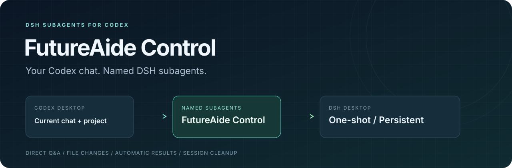

# FutureAide Control · DSH Control

让 Codex 按名字调用 DSH 子代理，在当前项目中完成画图、写代码和文档等任务。每个 Codex 聊天有自己的代理名单，插件自动绑定项目路径、会话身份和回包目标。

- **简单派活**：创建时只选名字和一次性/长期，直接发送任务文字。
- **直接交流**：DSH 的问题回到原聊天，Codex 按名字回答；由助手显式调用 `report_parent` 决定何时回包，正文只转发它提交的内容。
- **多层分工**：DSH 助手可继续安排下属，Codex 仍只按顶层名字联系；顶层主动提交最终交付后，等待整棵树收尾再回包。
- **随时监工**：列表显示各层任务、活动、待答问题和文件归属，需要时再查差异或上下文。
- **管理生命周期**：一次性任务显式 final 报告送达且整树收尾后清除会话；长期代理保留上下文，按名字继续使用。

0.5 的默认入口是 Codex Desktop 插件，无需填写内部 ID 或创建传信 txt。0.5.5 同时包含定点派单/监控与轻量巡检两项修复：受管模型选择、发送、等待、读取及监控改用绑定 DSH 会话的 `managedStatus` / `throughSeq` / `read` 定点读取路径，不再反复列出全部会话；多个 MCP 连接的健康检查与共享监听器改用轻量数据库查询，不再周期性加载全部代理历史。闲置释放、按需唤醒和原任务恢复语义不变。版本变化见 [CHANGELOG](CHANGELOG.md)。

## 安装

准备以下环境：

- Windows 上的 **Codex Desktop** 和已打开、可正常使用的 **DSH Desktop**。
- **Node.js 24.14 或更高版本**；使用下列克隆方式还需要 Git。
- 在 DSH 内配置模型账号和默认模型。当前一键安装接入其 `desktop` profile，会话清理适配 DSH **0.2.1-rc.3**。

在 PowerShell 中克隆仓库并安装。下面的 `D:\Tools\FutureAide-Control` 是示例，可以换成其他**非 C 盘的稳定目录**；安装器会拒绝 C 盘源目录。

```powershell
git clone https://github.com/XianYuLSya/FutureAide-Control.git D:\Tools\FutureAide-Control
Set-Location D:\Tools\FutureAide-Control
.\install.ps1
```

安装器准备依赖、注册并启用 Codex 插件、配置 DSH Host 桥接。它保留其他 Codex/DSH 设置，并为改动文件保存备份。运行入口指向克隆目录，私有配置和状态位于其中的 `.runtime/`，请保留该目录的位置。

安装或升级后，在 Codex 的插件/MCP 设置中**重启或重新加载插件连接**；如果新增插件尚未出现，再重启 Codex Desktop。在项目聊天中让 Codex 调用：

```text
futureaide_status({})
```

确认工具已加载、聊天上下文已校验、DSH 已连接且 `treeProtocolReady: true`、`reportProtocolReady: true`、`ready: true`，即可派活。也可以直接说：“检查 FutureAide Control 是否就绪。” 如果工具尚未出现，先检查插件是否启用，再重启客户端。使用时保持 DSH Desktop 运行，模型与网络设置继续由 DSH 管理。

使用自定义 DSH 数据目录时，安装可加 `-DshHome 'E:\DSH-data'`；重装会保留已保存的选择。升级可在原目录执行 `git pull`、重新运行 `install.ps1`，然后重新加载插件连接。

从 0.4 升级到 0.5 前，先让正在运行的任务完成。需要保留在途任务升级时，还须按原任务身份切换后台 `scoped-worker`；仅重新加载 MCP 不会替换已经启动的监工进程，也不要重新派发任务来代替迁移。

宿主只支持 DSH。未指定实例时只读取 DSH 的注册记录，默认数据目录为 `DSH_HOME` 或 `~/.dsh`；不再发现或连接旧 FutureAide 应用，不读取其 shell、端口或启动日志，也不使用旧应用环境变量覆盖宿主。手工维护配置中的 `target` 只能为 `dsh`，已有 `auto` / `futureaide` 配置会明确报错；安装器会生成固定 DSH 配置。`futureaide_*` 工具名和已有 DSH 状态字段保持兼容。

维护 CLI 默认使用此安装目录的 `.runtime/config.json`；`--config` 和配置环境变量可显式选择其他配置。桌面桥接若已绑定不同凭据或托管状态目录，安装会报告冲突并保留原绑定；只有确定要迁移时才使用 `desktop-host-install --rebind` 或 `connect-desktop.ps1 -Rebind`。

## 单代理：完成一次画图任务

直接对 Codex 说：“创建一次性画图助手，为当前项目生成中文架构图，保存为 `docs/architecture.svg`。” Codex 的工具调用如下，代码块是 MCP 调用示例，无需在终端执行：

```text
futureaide_create_agent({name: "画图助手", lifetime: "once"})
futureaide_send_agent({name: "画图助手", message: "阅读当前项目，生成中文架构图，保存为 docs/architecture.svg。"})
```

创建不会启动模型轮次，收到任务后才开始工作。如果 DSH 询问图中需要包含哪些模块，问题会主动回到当前聊天，Codex 按名字回答即可：

```text
futureaide_answer_agent({name: "画图助手", message: "包含入口、主要模块、数据存储及它们的调用关系。"})
```

任务继续执行。DSH 助手在约定节点、需要 Codex 处理的事项或提交最终交付时，通过插件工具 `report_parent` 回传；日常进度留在任务记录。用 `final: true` 提交最终报告。普通回复、轮次结束和树空闲都不会唤醒 Codex。一次性助手的 final 报告确认送达且整树收尾后退出名单并清除会话数据，SVG 项目文件和已送达的回答保留。执行过程中可用 `futureaide_list_agents({})` 看进度，或用 `futureaide_agent_changes({name: "画图助手"})` 查看已观测到的修改。

已加载的旧 MCP 模块在插件/MCP 连接重新加载前仍走旧的前台路径；新的后台 worker 会优先使用绑定会话的定点等待/读取路径。

## 多代理：并行分工与长期复用

例如让一个长期助手画图，另一个一次性助手整理说明，分别写入不同文件：

```text
futureaide_create_agent({name: "架构图助手", lifetime: "persistent"})
futureaide_create_agent({name: "说明助手", lifetime: "once"})

futureaide_send_agent({name: "架构图助手", message: "阅读代码，将中文架构图写入 docs/architecture.svg，仅修改这个文件。"})
futureaide_send_agent({name: "说明助手", message: "阅读代码，将模块职责与调用关系写入 docs/architecture.md，仅修改这个文件。"})

futureaide_list_agents({})
futureaide_wait_agents({names: ["架构图助手", "说明助手"], timeout_seconds: 30})
```

两者分别提问和回包，Codex 统一协调。名单按聊天隔离，同名助手可以存在于不同聊天；代理使用项目的实际文件路径，并行任务应明确文件分工。

第一项任务结束后，可以继续使用长期助手的上下文：

```text
futureaide_send_agent({name: "架构图助手", message: "沿用刚才的架构图，增加图例并统一模块配色。"})
```

不再需要时，按名字清除长期助手及会话数据：

```text
futureaide_delete_agent({name: "架构图助手"})
```

## 让 DSH 团队长继续分配下属

Codex 只创建和联系团队长，由它通过 DSH 原生委派工具组织下属，下属也可以继续向下分工。例如：

```text
futureaide_create_agent({name: "设计团队长", lifetime: "persistent"})
futureaide_send_agent({name: "设计团队长", message: "组织下属分别分析架构和模块职责，明确文件分工；需要时继续分配下级，最后汇总结果。"})
futureaide_list_agents({})
futureaide_inspect_agent({name: "设计团队长"})
```

下属通过原生消息联系直接父级，需要 Codex 决定的问题由顶层提出；Codex 继续按顶层名字回答。插件不设固定层数上限，模型与工具权限仍由 DSH 管理。

## 工具与生命周期

| 工具 | 用途 |
|---|---|
| `futureaide_status` | 检查当前聊天绑定与 DSH 桥接 |
| `futureaide_create_agent` | 创建一次性或长期子代理 |
| `futureaide_send_agent` | 发任务、运行中补充；等待回答时也可直接答复 |
| `futureaide_answer_agent` | 回答当前待答问题 |
| `futureaide_list_agents` | 查看本聊天名单、任务、活动、问题和修改摘要 |
| `futureaide_wait_agents` | 按需等一个或多个名字，单次最多 45 秒 |
| `futureaide_agent_changes` | 看具体修改路径和可得的内容差异 |
| `futureaide_inspect_agent` | 深入查看上下文、工具及任务历史 |
| `futureaide_cancel_agent` | 停止当前任务并清除未执行输入 |
| `futureaide_delete_agent` | 关闭代理并清除其会话数据 |

发送任务或补充消息返回精简受理回执；需要任务树、文件变更或历史时，按需使用列表、变更或查看工具。`queued: true` 表示已在本地保存（普通监工忙时进入持久队列），不得重发；`retrying: true` 表示原请求正等待后台恢复，调用方无需重发；`unknown` 表示原生写入结果不明，重试前先核对原回执和原收件人，绝不盲目重复；`accepted: true` 只表示 DSH 已受理，不代表任务完成或要求已落实。列表展示队列状态。

任务树已静止且没有执行中或排队输入的等待代理可休眠其独立监工，列表显示 `monitor: sleeping`；发送或回答会唤醒它。共享监听器通常在宿主持久记录变化时唤醒，约每 30 秒补扫并处理待投递报告或问题。若所有插件连接及监听器均关闭，下次连接时恢复检查。

取消请求优先送到所属代理，即使普通监工操作正忙也不必等待其释放操作锁。返回 `accepted` 表示请求已被宿主接受；通过列表确认任务树停止，取消不会撤销已经发生的操作。若自动清理已经开始，取消返回未接受。

列表保持简短，文件全文只在请求详细变更时返回。文件观察优先采用本代理原生文件工具的成功结果；shell 或外部程序写入仍可能只有部分覆盖，工具会明确说明，不把共享项目的全部改动归给某个代理。

DSH 助手可以继续调用其原生子代理，形成多层任务树；Codex 仍只按顶层名字操作。列表和变更会显示下属层级、活动以及文件的 `agentPath` 归属，`inspect_agent` 可深入查看该树的对话。顶层一轮结束不等于整项任务完成：只有顶层助手显式提交 final 报告，插件才在子孙执行与原生通知全部收齐后转发其正文，并为一次性助手清理整棵受管树。下属向其 DSH 父级汇总，不直接报告 Codex。取消或删除顶层名字也作用于它的下属树，不影响其他聊天的代理。

普通 Codex 聊天支持后台回包；当前桌面对原生 multi-agent v2 子代理调用者拒绝后台回包。遇到该明确拒绝时，插件显示 `native-callback-unavailable`、保留未送达报告和原收件人，并停止重复投递。

**一次性**完成一项任务，过程中可以多次提问、回答和显式报告。非 final 报告不会结束任务。成功的 final 报告确认送达且整树收尾后，插件关闭实例、删除该会话数据及私有记录，再移出名单。取消或失败只更新可见状态，不自动发送通知或清理；已提交的报告仍继续交付，代理可由用户按名字删除。清理失败仍显示在列表。已回到 Codex 的结果与项目产物保留。

**长期**显式 final 报告完成交付后回到空闲，留在名单中，下一项任务使用原上下文。没有 final 时显示 `awaiting_report`，同名发送继续原任务；final 已提交但尚未交付时不接受追加消息。只有按名字删除时才清除会话数据；停止当前任务不等于删除代理。取消或失败后，没有待投报告的长期代理可在同一会话开始新任务；一次性代理需显式删除。用户主动删除会同时丢弃尚未交付的报告。

`wait_agents` 遇到已自动退出的名字会返回 `notListed`，完成情况以已收到的结果为准。多代理组织由 Codex 负责，受管 DSH 助手使用各自的任务会话。

## 连接与结果

插件使用本机 MCP 与 DSH 桥接。任务回执、问题、答案及待回包结果持久保存；连接恢复后按原任务继续，不新建代理顶替。发送情况不明时先核对原生证据，回包情况不明时核对原聊天，不盲目发送第二份。

`delivery_pending` 表示工作已完成、结果正在等待交付；此时一次性会话尚未删除。已持久保存且具备交付条件的显式报告可在 DSH 暂时离线时继续交付。旧版本自动生成的结果缓存不会被转换成报告或触发自动清理。插件工具被客户端卸载或尚未加载时，需要重新启用或重新加载插件连接；未恢复时再重启 Codex。

### 某些聊天提示 `Transport closed`

每个聊天都有自己的调用连接和代理名单。一个聊天能用，不代表其他聊天的连接正常；插件没有“只允许一个聊天使用”的限制。若工具直接返回 `Transport closed`，尤其 Codex 内置工具也同样失败，应恢复 Codex 持有的连接。重新派发 DSH 任务或只重启 DSH 不能代替这一步。

克隆目录提供独立的 [recover.cmd](recover.cmd)：在**文件资源管理器**中双击，输入 `R`，即可完整退出 Codex 及其后台进程并重新打开。它保留原启动路径和参数，包括代理参数；不删除聊天、代理记录或项目文件，不重启 DSH。此操作会中断 Codex 正在执行的聊天，并可能暂时停止回包 worker，请在合适的时候执行。不要在 Codex 自己的终端或工具中运行重启操作。

只检查目标进程时，在克隆目录运行：

```powershell
powershell.exe -NoProfile -ExecutionPolicy Bypass -File .\scripts\recover-codex.ps1 -Check
```

这项检查不重启应用，也不代表聊天连接已恢复。重新打开后，**在每个受影响的原聊天**调用 `futureaide_status({})` 和 `futureaide_list_agents({})`，核对原名单，再继续原任务。恢复入口不依赖已断开的 MCP 通道；目前不自动重启整个 Codex，也未将此入口宣称为客户端断连根因的修复。

本次多聊天断连已通过逐进程审计确认来自外部定时清理器：它将暂时无 CPU/I/O 活动的后台 MCP 误判为残留并终止。MCP 没有窗口、等待请求时不活动，都不表示连接已无用。若运行类似进程清理工具，应保留存活 Codex 进程树内的工具，仅清理能确认失去所属关系的残留；停止误杀后，还需在 Codex 设置重载已关闭的 MCP 连接。该外部清理器不属于本插件，其他 Transport closed 仍应依据各自日志判断。

后台 worker 异步启动失败的修补是另一个独立缺陷。安装配置下，新启动的 MCP 进程会在 `.runtime/diagnostics/` 记录精简生命周期日志，包含进程、工具名和聊天身份，不包含任务正文、结果或凭据。

## 维护与兼容

默认名字式工具依赖本机 Codex Desktop 的可信聊天上下文和回传通道。其他 MCP 客户端，以及仅有 DSH web/tui profile 的环境，需要相应适配；它们不具备这里描述的默认接入体验。

原生会话清理支持上述 DSH 版本的 JSONL 会话、项目索引和派生缓存；不支持的存储后端会返回清理失败。整树清理支持本机原生 one-shot / continuable 下属；外部托管的下属会明确报告不支持自动清理。文件观测会注明覆盖范围；当前派单接口使用文字，图片附件尚不是一等输入参数。

显式 ID 的 CLI 仍可用于 DSH 维护，查看 `node src/cli.mjs --help`。需要该 MCP 管理面时，在维护环境设置 `FUTUREAIDE_LEGACY_TOOLS=1`；它与默认名字工具面择一启用。这里的 legacy 指维护接口，不表示仍支持旧 FutureAide 宿主。详细用法见 [旧版 CLI 与显式接口](skills/futureaide-control/references/legacy-workflows.md)。DSH 版本使用的 slash / dot HTTP API 适配均保留，status 中的 `apiDialect: legacy` 只表示 slash 协议。

QQ 交流群：259109974。
