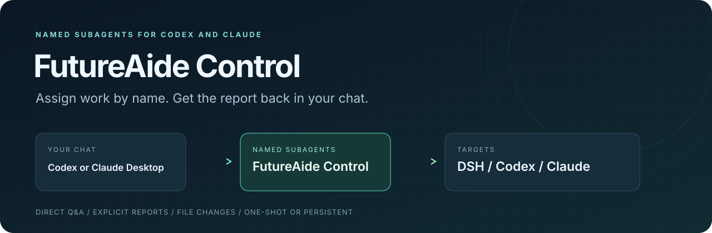

# FutureAide Control

在 Codex 或 Claude Desktop 聊天里按名字把当前项目的任务派给 DSH、Codex Desktop 或 Claude CLI。Claude CLI 在后台运行，Codex Desktop 目标需要本地调试端口。插件自动识别当前聊天和项目；每个调用方有自己的名单。

> **0.5.15（2026-11-06）** 支持 `target: "claude-cli"`。Codex 和 Claude 对话都已实测按名字派单给后台 Claude，后续任务可接续同一会话。用法见下文“调用 Claude CLI”。

- **派单时选模型**。在 `run`、`create` 或 `send` 传入 `model` 和可选的 `effort`，同一个名字的后续输入会沿用选择。
- **直接交流**：助手用 `ask_parent` 提问，父级按名字回答；显式 `report_parent` 决定何时回包，正文只转发它提交的内容。
- **多层分工**：助手可安排原生下属，受管 Codex 也可用同一套工具跨应用分工；顶层最终交付等待整棵树收尾。
- **随时监工**：列表显示各层任务、活动、待答问题和文件归属，需要时再查差异或上下文。
- **管理生命周期**：一次性任务显式 final 报告送达且整树收尾后清除会话；长期代理保留上下文，按名字继续使用。

无需填写项目路径、内部 ID 或创建传信 txt。从未指定模型的名字跟随目标应用的当前默认设置。版本变化见 [CHANGELOG](CHANGELOG.md)。

## 调用 Codex Desktop，与调用 DSH 同一流程

保持目标桌面应用运行。`futureaide_status({})` 中，各后端的 `models` 依目录顺序列出可选 ID，`defaultModel` 给出默认 ID。假设目录里有包含 `astra` 的模型，且支持 `high`，可以这样调用。

```text
futureaide_run_agent({name: "审阅搭档", target: "codex-desktop", model: "astra", effort: "high", message: "检查当前修改并报告发现。"})
```

`model` 忽略大小写，先找完全相同的 ID，再选包含该片段的第一项。回执、`list` 和 `wait` 的 `actualModel` 显示解析出的完整 ID。找不到模型时，错误会列出可选 ID。`effort` 必须是所选模型支持的档位，每次显式指定 `model` 时省略它会采用该模型默认档位。后续任务、补充、回答和提醒沿用这个名字的选择。DSH 通过本版宿主桥把显式选择应用到该会话，其他名字仍可跟随应用默认模型。若工具提示更新宿主桥，使用本版安装流程同步 DSH 端后再派单。已选模型的名字也可以单传 `effort` 调整档位。

也可以先创建，稍后再派单。

```text
futureaide_create_agent({name: "方案搭档", lifetime: "persistent", target: "codex-desktop"})
futureaide_send_agent({name: "方案搭档", message: "阅读当前项目，检查方案并提出改进；需要确认就 ask_parent，完成后 report_parent(final:true)。"})
futureaide_list_agents({})
```

Codex 在自己的会话中工作；提问和显式报告回到创建它的聊天。父级用 `futureaide_answer_agent` 回答、`futureaide_agent_changes` 看文件、`futureaide_inspect_agent` 看上下文。省略 `target` 就调用 DSH。

Codex Desktop 目标要求 Codex 由 **FAswitch** 打开：调试端口是启动器加的，Codex 自身不开。插件经主渲染进程的本地调试端口发 `thread/start`、`turn/start`，与界面新建对话走同一个入口；后续发送、补充、打断、删除和观察也走这条 app-server RPC，不读 `state_5.sqlite`、`thread_history_1.sqlite` 或 rollout 文件，也不再用 app-tools 的 `create_thread` 借锚点。已选模型的名字在 `turn/start` 传入完整模型和推理档位。其余名字由 Codex 决定模型和档位。Codex 的 `turn/steer` 只补充当前轮次，运行中换模型或档位会报错，请等该轮结束后再发送。权限沿用 Codex 设置。标题不在首轮返回时硬设：等会话有内容后再补 `thread/name/set`，失败最多重试 5 次且不影响任务。没有调试端口时 `futureaide_status` 的 `codex-desktop` 项会报 `codex-native-rpc-unavailable`，并提示从 FAswitch 打开 Codex；此时普通 Codex 对话调用 DSH 仍走 app-tools，不受影响。已知限制：取消会停下模型这一轮，但 Codex 已经启动的 shell 命令不会被杀（实测 `turn/interrupt` 之后 `Start-Sleep` 还在跑）。

`once` 在成功 final 送达且整树收尾后自动移出名单并清理插件记录，保留项目产物；`persistent` 留下同一上下文供下一项任务使用。按名字取消保留上下文，按名字删除清理它拥有的整棵会话树。桌面调用的 `queued:true` 表示已持久保存，后续由监控推进，调用方无需重复发送。

## 调用 Claude CLI

从 Codex 或 Claude 的当前聊天都可以创建 `claude-cli` 助手。从安装目录可用下面两条命令找到 Desktop 捆绑的 CLI，并登录它自己的账号。

```powershell
$claudeCli = node --input-type=module -e "import {findClaudeCli} from './scripts/install-plugin.mjs'; console.log(await findClaudeCli())"
& $claudeCli auth login
```

登录后查看 `futureaide_status({})` 中 `backends["claude-cli"]` 的 `ready`、`reason` 和 `models`。FAswitch 把当前档案的代理写入 Claude 用户设置，CLI 自行加载。无头进程可以独立于调用方的 MCP 连接继续执行，执行端全程无需打开 Claude 对话。

```text
futureaide_run_agent({name: "审稿", target: "claude-cli", lifetime: "persistent", message: "检查当前项目的改动，完成后用 report_parent 提交最终报告。"})
futureaide_send_agent({name: "审稿", message: "接着检查刚才提到的第二处。"})
```

同名长期助手接续原会话。`once` 收尾和按名字 `delete` 都会停止受管进程、清理插件私有记录。Claude CLI 自己保存的会话历史保留在用户目录，删除排队回执会标明 `nativeHistoryPolicy: "retain"`。省略 `model` 让 CLI 选用默认模型，`list`、`wait` 在 CLI 发出 `system/init` 后显示实际模型。CLI 接收 `low`、`medium`、`high`、`xhigh`、`max`，各模型与强度的组合待实机验证。后台权限使用 `auto`，需要人工批准的操作会被拒绝，详情可在 `inspect` 查看。`ask_parent` 和 `report_parent` 由插件送回派单的聊天，最终交付需要 `report_parent` 的 `final: true`。

## 安装

准备以下环境：

- Windows 上的 **Codex Desktop** 和已打开、可正常使用的 **DSH Desktop**。
- **Node.js 24.14 或更高版本**；使用下列克隆方式还需要 Git。
- 在 DSH 内配置模型账号和默认模型。当前一键安装接入其 `desktop` profile，会话清理适配 DSH **0.2.1-rc.3**。

在 PowerShell 中克隆仓库并安装。下面的 `D:\Tools\FutureAide-Control` 是示例，可以换成其他**非 C 盘的稳定目录**；安装器会拒绝 C 盘源目录。

```powershell
git clone https://github.com/XianYuLSya/FutureAide-Control.git D:\Tools\FutureAide-Control
Set-Location D:\Tools\FutureAide-Control
.\install.ps1
```

安装器准备依赖、注册并启用 Codex 插件、配置 DSH Host 桥接，同时把 FutureAide Control 注册为 Claude 的用户级插件，装完在 Claude 新开一个会话即可按名字使用。它保留其他 Codex/DSH 设置，并为改动文件保存备份。运行入口指向克隆目录，私有配置和状态位于其中的 `.runtime/`，请保留该目录的位置。

安装或升级后，在 Codex 的插件/MCP 设置中**重启或重新加载插件连接**；如果新增插件尚未出现，再重启 Codex Desktop。在项目聊天中让 Codex 调用：

```text
futureaide_status({})
```

确认工具已加载、聊天上下文已校验、DSH 已连接且 `treeProtocolReady: true`、`reportProtocolReady: true`、`ready: true`，即可派活。也可以直接说：“检查 FutureAide Control 是否就绪。” 如果工具尚未出现，先检查插件是否启用，再重启客户端。使用时保持 DSH Desktop 运行，模型与网络设置继续由 DSH 管理。

Claude 侧的桥接进程声明了 `tools.listChanged`：服务端的工具名或 schema 变化后（重连时或每 45 秒的比对中）会向已打开的会话发 `tools/list_changed`，不必为看到新工具而新开会话；比对本身失败只记日志，不影响工具调用。

使用自定义 DSH 数据目录时，安装可加 `-DshHome 'E:\DSH-data'`；重装会保留已保存的选择。升级可在原目录执行 `git pull`、重新运行 `install.ps1`，然后重新加载插件连接。

升级后若旧监工 `scoped-worker` 仍在运行，已排队的 `claude-cli` 任务会停在队列里。请重启监工，让它加载新版。

从 0.4 升级到 0.5 前，先让正在运行的任务完成。需要保留在途任务升级时，还须按原任务身份切换后台 `scoped-worker`；仅重新加载 MCP 不会替换已经启动的监工进程，也不要重新派发任务来代替迁移。

宿主目标由 `target` 决定：`dsh`（默认）、`codex-desktop`、`claude-cli`。DSH 路径未指定实例时只读取 DSH 的注册记录，默认数据目录为 `DSH_HOME` 或 `~/.dsh`。Codex Desktop 目标使用经 FAswitch 启动的应用主渲染进程：插件只经本地调试端口调用 Codex 自己的 app-server RPC，不读取账号凭据，不启动独立 CLI 或第二个 app-server，也不读 Codex 的数据库、thread history 或 rollout 文件；没有调试端口时 `status` 明确报不可用并提示从 FAswitch 打开，不以 app-tools 创建会话顶替。旧 FutureAide 应用的 shell、端口、启动日志与环境变量覆盖一律不使用。手工维护配置中的 `target` 只能为 `dsh`，已有 `auto` / `futureaide` 配置会明确报错；安装器会生成固定 DSH 配置。`futureaide_*` 工具名和已有 DSH 状态字段保持兼容。

维护 CLI 默认使用此安装目录的 `.runtime/config.json`；`--config` 和配置环境变量可显式选择其他配置。桌面桥接若已绑定不同凭据或托管状态目录，安装会报告冲突并保留原绑定；只有确定要迁移时才使用 `desktop-host-install --rebind` 或 `connect-desktop.ps1 -Rebind`。

## 单代理：完成一次画图任务

直接对 Codex 说：“创建一次性画图助手，为当前项目生成中文架构图，保存为 `docs/architecture.svg`。” Codex 的工具调用如下，代码块是 MCP 调用示例，无需在终端执行：

```text
futureaide_run_agent({name: "画图助手", lifetime: "once", message: "阅读当前项目，生成中文架构图，保存为 docs/architecture.svg。"})
```

`run` 一次完成创建与派单，可以省略 `name` 让插件生成；名字已存在时直接把任务发给它。创建本身不会启动模型轮次，收到任务后才开始工作。从未指定模型的名字在下一次输入派出时读取 DSH 默认模型。正在执行的模型请求继续完成，失败任务不会自动重放，休眠代理不会为切换而全部唤醒；同一输入的后台恢复保留最初已确定的模型和请求身份。DSH 原生下属的新建与复用仍遵循其自身的模型继承和显式选择规则。

如果 DSH 询问图中需要包含哪些模块，问题会主动回到当前聊天，Codex 按名字回答即可：

```text
futureaide_answer_agent({name: "画图助手", message: "包含入口、主要模块、数据存储及它们的调用关系。"})
```

任务继续执行。DSH 助手在约定节点、需要 Codex 处理的事项或提交最终交付时，通过插件工具 `report_parent` 回传；日常进度留在任务记录。用 `final: true` 提交最终报告。普通回复、轮次结束和树空闲都不会唤醒 Codex。一次性助手的 final 报告确认送达且整树收尾后退出名单并清除会话数据，SVG 项目文件和已送达的回答保留。执行过程中可用 `futureaide_list_agents({})` 看进度，或用 `futureaide_agent_changes({name: "画图助手"})` 查看已观测到的修改。

已加载的旧 MCP 模块在插件/MCP 连接重新加载前仍走旧的前台路径；新的后台 worker 会优先使用绑定会话的定点等待/读取路径。

## 多代理：并行分工与长期复用

例如让一个长期助手画图，另一个一次性助手整理说明，分别写入不同文件：

```text
futureaide_create_agent({name: "架构图助手", lifetime: "persistent"})
futureaide_create_agent({name: "说明助手", lifetime: "once"})

futureaide_send_agent({name: "架构图助手", message: "阅读代码，将中文架构图写入 docs/architecture.svg，仅修改这个文件。"})
futureaide_send_agent({name: "说明助手", message: "阅读代码，将模块职责与调用关系写入 docs/architecture.md，仅修改这个文件。"})

futureaide_list_agents({})
futureaide_wait_agents({names: ["架构图助手", "说明助手"], timeout_seconds: 30})
```

两者分别提问和回包，Codex 统一协调。名单按聊天隔离，同名助手可以存在于不同聊天；代理使用项目的实际文件路径，并行任务应明确文件分工。

第一项任务结束后，可以继续使用长期助手的上下文：

```text
futureaide_send_agent({name: "架构图助手", message: "沿用刚才的架构图，增加图例并统一模块配色。"})
```

不再需要时，按名字清除长期助手及会话数据：

```text
futureaide_delete_agent({name: "架构图助手"})
```

## 让 DSH 助手继续分工

Codex 可以把任务发给一个 DSH 助手，由它用 DSH 原生工具继续分工。

```text
futureaide_create_agent({name: "设计助手", lifetime: "persistent"})
futureaide_send_agent({name: "设计助手", message: "组织下属分别分析架构和模块职责，明确文件分工；需要时继续分配下级，最后汇总结果。"})
futureaide_list_agents({})
futureaide_inspect_agent({name: "设计助手"})
```

下属通过原生消息联系直接父级，需要 Codex 决定的问题由顶层提出；Codex 继续按顶层名字回答。插件不设固定层数上限，模型与工具权限仍由 DSH 管理。

## 工具与生命周期

| 工具 | 用途 |
|---|---|
| `futureaide_status` | 查看当前调用方、项目和各后端的就绪状态、可用模型 ID 与默认模型 |
| `futureaide_run_agent` | 一步创建并派单，可选 `model` 和 `effort`。已有名字直接接收任务，省略 `name` 时自动生成 |
| `futureaide_create_agent` | 为一次性或长期子代理预留名字，可选 `target`、`model` 和 `effort` |
| `futureaide_send_agent` | 按名字派单、补充或回答，也可用 `model` 或 `effort` 更新选择 |
| `futureaide_answer_agent` | 回答当前待答问题 |
| `futureaide_list_agents` | 查看本聊天名单；有下属的名字用 `team` 一行一人列出整棵树 |
| `futureaide_wait_agents` | 按需等一个或多个名字，单次最多 45 秒 |
| `futureaide_agent_changes` | 看具体修改路径；每个路径一行，不带文件正文 |
| `futureaide_inspect_agent` | 深入查看上下文、工具及任务历史；`node` 只看一个成员 |
| `futureaide_cancel_agent` | 停止当前任务及所属后代，清除未执行输入，保留上下文 |
| `futureaide_delete_agent` | 关闭代理及所属后代，清除会话数据，保留项目产物 |

受管子代理侧另有两个工具：`ask_parent` 提问、`report_parent` 显式报告，由插件在目标会话内提供；普通输出、轮次结束与树空闲都不产生回包。DSH 助手的一轮结束却没有 final 报告时，插件会在同一任务里提醒它一次（主控侧不产生通知，任务保持 running）；失败或取消的轮次不提醒，提醒后仍没有 final 就正常停在 `awaiting_report`，同一任务不会重复提醒。Codex 目标的补充走自己的持久队列，这次未加此提醒。两者的说明里带着同一份回报契约：`report_parent` 要求按 Result / Changes / Verified / Not verified / Decisions 分段、控制在 300 词内，负责汇总的助手提交一份报告；`ask_parent` 要求写清要定的决定、选项与建议。Codex、DSH 两侧用的是同一段文本。

上级看全队只用一次 `futureaide_list_agents`：有下属的名字返回 `team`，后代每人一行（相对根、可寻址的 `path`、状态、运行时活动、文件数，文件数封顶时显示 `12+`），最多 30 行，超出以 `{more:n}` 收尾；两个成员同名时第二个起用 `名字#2`、`名字#3`。宿主读不到树时条目带 `treeError` 且没有 `team`——那是未知，不是“没有下属”。需要某个成员的对话时用 `futureaide_inspect_agent({name, node})`：`node` 取 `team` 里的路径（如 `"设计助手/前端"`、`"subagent#2"`）或成员名，路径优先；被省略成 `…` 的路径按前缀匹配；同名命中多个成员时以 `node-ambiguous` 拒绝并给出可用路径，其余节点只留名字和状态。整份答案仍超长时先把每个 `team` 换成 `teamSize` 计数并加一条提示，再超才退化成 preview。

发送任务或补充消息返回精简受理回执；需要任务树、文件变更或历史时，按需使用列表、变更或查看工具。`queued: true` 表示已在本地保存（普通监工忙时进入持久队列），不得重发；`retrying: true` 表示原请求正等待后台恢复，调用方无需重发；`unknown` 表示原生写入结果不明，重试前先核对原回执和原收件人，绝不盲目重复；`accepted: true` 只表示目标宿主已受理，不代表任务完成或要求已落实。列表展示队列状态。

桌面目标的首次派发、忙时补充、取消与删除同样是**持久排队意图**：受理后不重发；执行者或监听器中断后按原 `requestId` 恢复原请求，已发出的不重放。

一个共享监控进程推进各名字的任务。任务树已静止且没有执行中或排队输入的等待代理显示 `monitor: sleeping`；发送或回答会唤醒它。监听器通常在宿主持久记录变化时唤醒，约每 30 秒补扫并处理待投递报告或问题。若所有插件连接及监听器均关闭，下次连接时恢复检查。Codex 子代理已结束而后台命令仍运行时，任务树继续显示运行中，取消也会停止该后台任务。

取消请求优先送到所属代理，即使普通监工操作正忙也不必等待其释放操作锁。返回 `accepted` 表示请求已被宿主接受；通过列表确认任务树停止，取消不会撤销已经发生的操作。若自动清理已经开始，取消返回未接受。

列表保持简短，文件全文只在请求详细变更时返回。五个读工具（`futureaide_status`、`futureaide_list_agents`、`futureaide_wait_agents`、`futureaide_agent_changes`、`futureaide_inspect_agent`）与 `futureaide_create_agent` 默认返回精简结构：列表条目只有名字、状态、生命周期、任务、待答问题、最新报告（含未送达数量）、改动文件计数（含精确的 unconfirmed 数量）、团队名单与停止的监控，覆盖率、时间戳、每个成员的改动清单和完整结果文字都不占上下文；`changes` 每条路径只留路径、操作，根以下的 `agentPath` 与 `unconfirmed` 归属才保留，文件正文只在 `detail: true` 时返回。文件观察优先采用本代理原生文件工具的成功结果。shell 写入靠任务前后的 `git status` 比对发现，这类条目标为 `attribution: unconfirmed`：同一时间别的进程或助手的改动也会出现，gitignore 覆盖的路径和非 git 目录看不到。仍可能只有部分覆盖，工具会明确说明，不把共享项目的全部改动归给某个代理。

DSH 助手可以继续调用其原生子代理，形成多层任务树；Codex 仍只按顶层名字操作。列表和变更会显示下属层级、活动以及文件的 `agentPath` 归属，`inspect_agent` 可深入查看该树的对话。顶层一轮结束不等于整项任务完成：只有顶层助手显式提交 final 报告，插件才在子孙执行与原生通知全部收齐后转发其正文，并为一次性助手清理整棵受管树。下属向其 DSH 父级汇总，不直接报告 Codex。取消或删除顶层名字也作用于它的下属树，不影响其他聊天的代理。

普通 Codex 聊天支持后台回包；当前桌面对原生 multi-agent v2 子代理调用者拒绝后台回包。遇到该明确拒绝时，插件显示 `native-callback-unavailable`、保留未送达报告和原收件人，并停止重复投递。

**一次性**完成一项任务，过程中可以多次提问、回答和显式报告。非 final 报告不会结束任务。成功的 final 报告确认送达且整树收尾后，插件关闭实例、清理私有记录并移出名单。DSH 与 Codex 目标清理其受管会话数据，Claude CLI 保留原生会话历史。取消只更新可见状态，不自动发送通知或清理；失败在确定终态时给直接上级发一次执行失败通知（不重试模型任务）；已提交的报告仍继续交付，代理可由用户按名字删除。清理失败仍显示在列表。已回到 Codex 的结果与项目产物保留。

**长期**显式 final 报告完成交付后回到空闲，留在名单中，下一项任务使用原上下文。没有 final 时显示 `awaiting_report`，同名发送继续原任务；final 已提交但尚未交付时不接受追加消息；派下一单时会先读回确认，回报已经进入对话就直接开始。只有按名字删除时才清除会话数据；停止当前任务不等于删除代理。取消或失败后，没有待投报告的长期代理可在同一会话开始新任务；一次性代理需显式删除。用户主动删除会同时丢弃尚未交付的报告。

模型请求失败时，列表和查看结果中的 `error.source: "model"` 给出稳定错误代码、可用的 HTTP 状态和简短提示。例如 `no_healthy_account` 表示所用模型网关当前没有健康账号。任务进入确定的失败终态时，插件复用报告投递给直接上级发一次执行失败通知（写明助手名、失败和简短原因），失败重试仍在进行时不发，上级自己取消的停止也不发；模型任务本身不会自动重试。失败原因保存在原任务中，新任务或后续成功会清除当前展示中的旧失败。升级前已失败的代理可通过一次正常查看补齐原因。

`wait_agents` 遇到已自动退出的名字会返回 `notListed`，完成情况以已收到的结果为准。多代理组织由 Codex 负责，受管 DSH 助手使用各自的任务会话。

## 连接与结果

插件使用本机 MCP 与目标应用的桌面接入。任务回执、问题、答案及待回包结果持久保存；连接恢复后按原任务继续，不新建代理顶替。发送情况不明时先核对原生证据，回包情况不明时核对原聊天，不盲目发送第二份。

`delivery_pending` 表示工作已完成、结果正在等待交付；此时一次性会话尚未删除。已持久保存且具备交付条件的显式报告可在 DSH 暂时离线时继续交付。旧版本自动生成的结果缓存不会被转换成报告或触发自动清理。插件工具被客户端卸载或尚未加载时，需要重新启用或重新加载插件连接；未恢复时再重启 Codex。

### 某些聊天提示 `Transport closed`

每个聊天都有自己的调用连接和代理名单。一个聊天能用，不代表其他聊天的连接正常；插件没有“只允许一个聊天使用”的限制。若工具直接返回 `Transport closed`，尤其 Codex 内置工具也同样失败，应恢复 Codex 持有的连接。重新派发 DSH 任务或只重启 DSH 不能代替这一步。

克隆目录提供独立的 [recover.cmd](recover.cmd)：在**文件资源管理器**中双击，输入 `R`，即可完整退出 Codex 及其后台进程并重新打开。它保留原启动路径和参数，包括代理参数；不删除聊天、代理记录或项目文件，不重启 DSH。此操作会中断 Codex 正在执行的聊天，并可能暂时停止回包 worker，请在合适的时候执行。不要在 Codex 自己的终端或工具中运行重启操作。

只检查目标进程时，在克隆目录运行：

```powershell
powershell.exe -NoProfile -ExecutionPolicy Bypass -File .\scripts\recover-codex.ps1 -Check
```

这项检查不重启应用，也不代表聊天连接已恢复。重新打开后，**在每个受影响的原聊天**调用 `futureaide_status({})` 和 `futureaide_list_agents({})`，核对原名单，再继续原任务。恢复入口不依赖已断开的 MCP 通道；目前不自动重启整个 Codex，也未将此入口宣称为客户端断连根因的修复。

本次多聊天断连已通过逐进程审计确认来自外部定时清理器：它将暂时无 CPU/I/O 活动的后台 MCP 误判为残留并终止。MCP 没有窗口、等待请求时不活动，都不表示连接已无用。若运行类似进程清理工具，应保留存活 Codex 进程树内的工具，仅清理能确认失去所属关系的残留；停止误杀后，还需在 Codex 设置重载已关闭的 MCP 连接。该外部清理器不属于本插件，其他 Transport closed 仍应依据各自日志判断。

后台 worker 异步启动失败的修补是另一个独立缺陷。安装配置下，新启动的 MCP 进程会在 `.runtime/diagnostics/` 记录精简生命周期日志，包含进程、工具名和聊天身份，不包含任务正文、结果或凭据。

**安装范围**：`install.ps1` 现在准备三样东西：Codex 插件、本机 DSH 主机桥接，以及 Claude 的**用户级插件**。安装器在 `.runtime/claude-marketplace` 生成一个只含清单、MCP 配置和 skill 的薄插件（运行目录仍以绝对路径指向 D 盘），随后依次执行 `claude plugin marketplace add … --scope user` 与 `claude plugin install futureaide-control@futureaide --scope user`。注册是用户级的，Claude 在**任何项目**发起的会话都能按名字调用 DSH 子代理，不必为每个项目单独写 `.mcp.json`。Claude 只在新开会话时加载插件，安装前已打开的会话不会自动生效，需要新开一个。找不到 `claude` 命令或注册失败都不影响 Codex 安装，返回值里 `claude.registered` 会是 `false` 并带原因；桌面端自带的 `claude.exe` 不在 PATH 时可用 `-ClaudeCli <path>` 指定，不想改 Claude 环境时用 `-SkipClaude`。插件从 D 盘原地加载，重新运行安装器重新生成文件即完成升级。Codex Desktop 注册尚未纳入一键安装。本机已完成三目标正式接入：Codex 的 `futureaide` 与 Claude 的 `futureaide-report` 都指向同一正式目录和状态库，旧开发注册已退役。日常调用不需要重新运行安装器。

## 本版验证结论（2026-11-04）

- **Claude → DSH 全链路已实机通过**：派单、问答、并行、多层树、上下文复用、取消、删除、会话重启后回报、忙时补充、shell 写入的 `changes`。
- **互调目标未重新验证**：Codex 互调的目标（`target: 'codex-desktop'`）在本版改动后尚未重新验证，仍按实验性处理。

## 已知未完成

- Codex 目标的原生 RPC 通道（创建、发送、补充、打断、删除、观察、调用方验证与回报送达）已按 app-server v2 schema 实现并通过全量测试，尚未在真实 Codex 上做本版验收；`thread/list` 的父线程过滤、冷线程 `thread/resume`、标题和侧栏可见性以实机为准。
- Codex → DSH 混合树的删除尚未重测。
- 退出整个应用再打开后的恢复未验证。

## 维护与兼容

名字式工具依赖已接入的 Codex 或 Claude Desktop 会话上下文和回传通道。其他 MCP 客户端，以及仅有 DSH web/tui profile 的环境，需要相应适配。

原生会话清理支持上述 DSH 版本的 JSONL 会话、项目索引和派生缓存；不支持的存储后端会返回清理失败。整树清理支持本机原生 one-shot / continuable 下属；外部托管的下属会明确报告不支持自动清理。文件观测会注明覆盖范围；当前派单接口使用文字，图片附件尚不是一等输入参数。

显式 ID 的 CLI 仍可用于 DSH 维护，查看 `node src/cli.mjs --help`。需要该 MCP 管理面时，在维护环境设置 `FUTUREAIDE_LEGACY_TOOLS=1`；它与默认名字工具面择一启用。这里的 legacy 指维护接口，不表示仍支持旧 FutureAide 宿主。详细用法见 [旧版 CLI 与显式接口](skills/futureaide-control/references/legacy-workflows.md)。DSH 版本使用的 slash / dot HTTP API 适配均保留，status 中的 `apiDialect: legacy` 只表示 slash 协议。

QQ 交流群：259109974。
